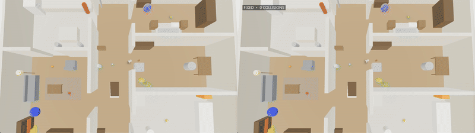
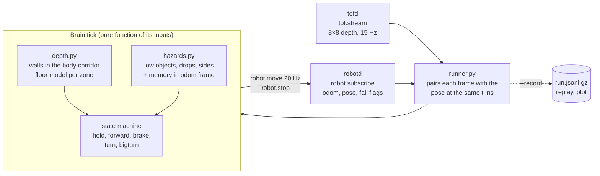

# microduck-brain

[](https://github.com/samoxis/microduck-brain/actions/workflows/tests.yml)



An autonomy layer for **Microduck**, the 25 cm open-source biped from Pollen Robotics / Hugging Face.
It runs as a separate client and talks to the robot only through its public JSON-RPC API over unix
sockets — the same calls `robotctl` makes — so it needs no changes to the robot's software.
Python 3.12, standard library only.

What the robot does with it:

- **walks and holds its heading**, cancelling the gait's drift with `odom.yaw` (a small PI loop);
- **steers around obstacles while walking**, and stops to turn in place only when there is no room;
- **avoids low objects** (7 cm cubes, 8 cm balls) that are only visible in the bottom rows of its
  8×8 depth sensor, using a geometric model of the floor;
- **keeps away from drops** (ledges, stairs going down);
- **remembers hazards it can no longer see**, in odometry coordinates;
- **stops sending walking commands when it falls or is unhealthy**, and resumes once it is upright;
- **records every decision** for exact offline replay and plots;
- optionally **explores**: prefers directions it has not been to yet (`[explore]`, off by default
  until measured in the full simulator);
- optionally **scans with its head** while walking (`[head]`, off by default): the sensor is on the
  head, so turning it left and right covers what the 45° view misses beside the legs;
- has an **observe mode** for a first run on a physical robot: it decides and records, but sends the
  robot nothing.


*A 300 s run in Pollen's full simulator, with the official walking policies, in the apartment scene:
the path coloured by state, a rough map built from wall returns, the stairwell it detected and kept
away from (black), and the two low objects it went around (green: a ball and a cube). Positions are
from the robot's own odometry. The recording is in [`docs/`](docs/) and replays exactly:
`uv run microduck-brain-replay docs/full-sim-run.jsonl.gz`.*

## Results

| Where | What was measured | Result |
|---|---|---|
| Full simulator, official walking policies (run by the author, [`tools/full_sim_run.sh`](tools/full_sim_run.sh)) | v0.3 (all behaviours), 300 s in the apartment | 44 m walked, 6.5 m² covered; 132 avoidances, 15 needing a stop; both low objects met (a ball, a cube) detected and avoided; the stairwell detected, closest approach of the trunk to its edge 0.18 m, never over it; **0 falls**; replay exact (5988 ticks) |
| Full simulator, official walking policies (run by the author) | v1 (before low objects and drops), 150 s in the apartment | 85 avoidances, only 4 needing a full stop; **0 falls**; area covered 4.5 × 3.4 m |
| Full simulator (run by the author) | Minimum commanded speeds at which the policy steps | 0.20 m/s forward, 1.1 rad/s turning; real speed ≈ 40% (forward) and 46–69% (turning) of commanded |
| MuJoCo apartment, kinematic body, real ToF model ([`tools/kinematic_apartment.py`](tools/kinematic_apartment.py); one run drawn in [`docs/apartment-run.svg`](docs/apartment-run.svg)) | 12 runs × 300 s from 6 rooms, two real turn rates: 334 m walked | **0 toy contacts, 0 entries over the stairwell**, 2 grazes of furniture (down from 22, see *Findings*), 791 avoidances |
| Real MuJoCo sensor frames ([`tests/fixtures/`](tests/fixtures/)) | Floor model vs. the simulated sensor | error σ 0.8% (max 2.8%) |
| Real MuJoCo sensor frames | False alarms on empty floor, trunk tilted ±3° pitch and roll | **0** in 96 frames (low objects) and 0 in 304 frames (drops, incl. 64 frames across the apartment's rooms) |
| Flat 2-D worlds, real beam geometry, measured real/commanded ratios ([`tests/world2d.py`](tests/world2d.py)) | Exploration on vs. off: 4 rooms × 30 seeds × 600 s | Area covered **+71%** (35.0 vs 20.5 m² summed over the 4 rooms, mean of 3 × 10 seeds), **0 contacts** in 120 runs either way |
| Full simulator, official walking policies (run by the author), apartment, 600 s each | Exploration off vs. on, first version (3fedf98) | Area 7.31 vs 7.50 m² (+2.6%, within single-run noise); avoidances 194 vs 327; 3 bends but 27 "aborts" — a bug: the abort rule also reset the ordinary heading hold near walls. Fixed; to be re-measured |
| Full simulator in a 4-core cloud container (`tools/ab_full_sim.sh`), apartment, 5 + 5 runs of 600 s alternating, frozen commit `0f9f816` | Exploration off vs. on | Area 7.04 ± 1.05 vs 7.74 ± 1.40 m² (5.25–8.06 vs 5.56–9.06): **noise**, the ranges overlap; avoidances 396 vs 388, noise; 0 falls. Why: 0.4 bends a run (2-D: ~20), because 43 of 45 attempts were refused — something beside the body (the apartment is cramped for a 10 cm/s robot) |
| Full simulator, cloud container, apartment, 5 + 5 runs of 600 s alternating, frozen commit `3b323ee` | Head scan off vs. on (±25°, 2.5 s) | Area 7.25 ± 1.30 vs 5.65 ± 2.26 m², avoidances 365 vs 410: **noise** both, the ranges overlap (the trend is the wrong way: −22% area). 0 falls with the scan on. Contacts, what the scan is for, were not measured in these runs (measured since: `MEASURE=1`) |
| Real MuJoCo frames, head pitched down with robot.head (`tests/fixtures/mujoco_head_pitch.json`) | Where a 7 cm cube is seen, and false alarms on empty floor | Level head: from 0.50 m. Pitched 20°: **from 0.20 m, no gap to 0.60 m**; 28.6°: from 0.16 m. 0 alarms in 48 empty-floor frames (the level-head arithmetic, unaware of the pitch, reads the floor as a wall in all 24 frames at ≥ 20°) |
| Flat 2-D worlds, 5 rooms incl. the dining room, homing after 240 s of walking (`[home]`, stuck detector on) | Gets back to where it started? | Fresh seeds 30–39: **arrived 100/100**, usually in 10–60 s; **0 contacts while homing** (3 contacts in the first 240 s, the same with homing off). Odometry is perfect here: in the full simulator home is only as good as the odometry |
| Flat 2-D worlds, a dining room with 28 table and chair legs of 3 cm, body 11 cm wide | Head scan off vs. on (±25°, 2.5 s), 30 runs × 600 s each | Contacts with legs **2 → 0** (at 12 cm: 3 → 1 in 15 runs); area +5–15%; but 2–4× more full stops, since it now sees what it used to brush past |
| Full simulator, cloud container, head scan on, 300 s | Does the policy keep its balance, does the sensor turn? | 0 falls; measured head yaw −27°…+29° for ±25° commanded, 0.3 s behind, 4° rms; replay exact |
| Full simulator, cloud container (`tools/push/push_trials.sh`) | Shoved sideways, ±1–3 m/s, 10 trials from a fresh simulator | Fell every time; **got up by itself 9 of 10** (2.0–2.8 s), once stuck on its side. With the brain running: walking again 4 s after the shove |
| Full simulator, cloud container, brain running, 2 × 20 shoves (±1–3 m/s) | `[recover]` off vs. on | Recovery off: 19 falls, all up by themselves in 1.9–3.1 s. Recovery on: 18 falls, 13 up by themselves; **5 stuck on their side** (gravity horizontal, 5–6 s without progress) **and all 5 up after one recovery**, 0.5 s after the policy restarts (10–13 s after the shove). Over all 47 falls so far, 6 stuck on a side: 13% |
| Test suite | 229 tests: synthetic and recorded frames, closed-loop worlds, a fake robot on real sockets, replay determinism | all passing, see the badge |

**What has not been verified**: anything on a physical robot (the author doesn't have one yet). In
the full-simulator run, contacts with furniture are not measured (the headless simulator doesn't report
them), and positions come from odometry, which drifts; the contact counts above are from the kinematic
runs only.

## Findings worth knowing

These came out of measuring rather than assuming, and each one changed the design:

1. **The policy has a dead zone.** Below 0.20 m/s forward or 1.1 rad/s turning the walking policy
   doesn't step at all; the first version (0.10 m/s) just stood still. The thresholds now live in the
   code and the brain warns at startup if the config is below them. The turning threshold, the
   real/commanded ratios and the drift were added to the upstream report,
   [pollen-robotics/microduck_rl#59](https://github.com/pollen-robotics/microduck_rl/issues/59).
2. **Turns must be measured, not timed.** The robot turns at roughly half the commanded rate, so a
   timed 160° turn came out around 80°. Turns now close the loop on `odom.yaw`.
3. **A 7 cm cube is invisible within ~45 cm.** Standing, the sensor is 24.6 cm high and level; its
   lowest beam dips 19.7°. A cube closer than ~45 cm is *under* every beam — the frame is identical to
   an empty floor (verified on simulator frames). Detection works at 0.45–0.7 m, so the brain
   remembers what it saw and steers around it after it disappears.
4. **The stairwell is visible only through a window.** Approaching the 40 cm-wide side of the
   stairwell, its far floor is already beyond the lowest beam's landing point at ~0.3 m, so the hole
   vanishes from view; drops are remembered for 120 s. (In the simulator a beam into the hole returns
   "nothing in range" because it passes under the floor slab; a real sensor would see the step as a
   longer range — both count. Reported upstream with a tested fix:
   [pollen-robotics/microduck_rl#76](https://github.com/pollen-robotics/microduck_rl/issues/76).)
5. **The foot of every wall looks like a low object.** The first closed-loop run reported 178 "low
   objects" in an apartment with 7 toys: 99.97% were wall bases seen by the bottom rows. A bottom-row
   reading now counts only if the wall rows above it are clear.
6. **The right leg brushed furniture.** In 12 runs, 22 contacts, *all* on the right side while
   walking straight: the sensor sits 2.2 cm left of the axis and "ahead" was defined as columns 1–6,
   so a post passing beside the right leg was never "ahead". "Ahead" is now the body's geometric
   corridor, and wall returns near the body are remembered for 3 s. Contacts dropped to 2, with the
   same area covered. The remaining two are the beak grazing a stool that was 54° to the right —
   outside the 45° field of view — while the robot arced away from something on its left; a longer
   memory didn't remove them, a wider view would (turning the head, or the camera).

7. **Without a goal, the brain settles into a loop.** In the flat 2-D worlds the reactive brain
   covers the same area at 300 s and at 900 s (4.19 vs 4.21 m² in a 4×3 m room): it follows the
   walls on a fixed circuit. Exploration breaks the loop with a handful of decisions per run (a few
   heading bends and side choices): +46% area. Its first version bent the heading towards a table
   corner beside the right leg — finding 6 again, plus the side memory expiring before the slow
   robot had walked past — so a side with anything near the body now gets no bends for 4 s.
   In the full simulator that abort rule misfired: it also cancelled the ordinary heading hold
   whenever the swaying trunk put the heading 6° off near a wall (27 "aborts" for 3 bends, and 69%
   more avoidances). Only a bend in progress can be aborted now, and every bend, refusal and abort
   is logged with its reason (`tools/explore_report.py` replays a recording and lists them).
   Next, 29 of 32 refusals in the full simulator were for bends to the right. In the 2-D worlds,
   with the walls known: 94% of all refusals pointed at a direction whose probed cells were *all*
   beyond a wall, and 82% were towards the side the nearest wall was on. "Unvisited" includes cells
   the robot can never reach; the side rule was refusing bends into walls, which is right, but it
   means the novelty measure is wrong, not the side rule. Now the wall returns are remembered as
   blocked cells and a probe stops at the first one. That roughly doubled the bends that complete,
   and the 2-D coverage went from +48% to +71%, with two more guards from the same map: no bend
   towards a wall remembered beside the body, none onto a course with a wall within 0.75 m (a table
   corner met head-on shows in a single zone, which the brain ignores as noise).

8. **Homing fought the avoidance.** The first version of going home, in the 2-D dining room, had a
   robot wedged between a table leg and a chair leg turn away (the avoidance), turn back towards
   home (the homing), and again, 65 times. Three fixes, each traced: plan a cell clear of remembered
   walls; after a full stop, homing gives way for 4 s counted from when it walks again (yielding to
   every small steer instead kept a robot circling a room for ever, wall to wall); and a stuck
   detector for a robot pressing on a leg the sensor reads as nothing, closer than its shortest
   range — it turns away from what is nearest beside it, all the way round.
9. **Looking down needs the whole pose.** Pitching the head 20° brings the 7 cm cube into view
   from 20 cm, but with the old arithmetic the upper rows, now seeing the floor, read it as a wall
   in every frame. With the head allowed to pitch, every return is placed with the sensor's full
   pose and a return that lands on the floor is floor, whatever row it is in.

## How it works



- **`depth.py`** turns a frame into a view ahead. For the bottom rows it computes, per zone, the
  range an empty floor would read, from the sensor's pose in `robot.state` (`frames.tof`,
  `safety.gravity`, `odom.position[2]`) — the same inputs the robot's own floor filter uses. Shorter
  means an object, longer (or nothing) means a drop.
- **`hazards.py`** confirms detections over time and remembers them in odometry coordinates.
- **`explore.py`** (optional) remembers the grid cells the robot has walked through, in odometry
  coordinates. At an obstacle, when both sides are about equally free, the brain turns towards the
  less visited one; while walking with a clear way it now and then bends its heading towards a less
  visited direction, within 60°.
- **`brain.py`** is the state machine. A safety guard sits above every state: fallen, unhealthy or
  blind means `hold`. New behaviours (dance, rest, play) are states registered with `brain.register()`.
- **`runner.py` / `ipc.py`** speak NDJSON JSON-RPC 2.0 to `robotd` and `tofd`, with the formats
  taken from `duck-ipc-proto` and `robotctl` rather than guessed.
- **`record.py`** writes every tick; because the brain is a pure function of its inputs, a recording
  replays exactly, and can be replayed with a different config to see what a change would have done.

## Quick start

On Linux or WSL, with Pollen's [`microduck`](https://github.com/pollen-robotics/microduck) and
[`microduck_rl`](https://github.com/pollen-robotics/microduck_rl) checked out and the simulator running:

```bash
curl -LsSf https://astral.sh/uv/install.sh | sh        # once
git clone https://github.com/samoxis/microduck-brain && cd microduck-brain

uv run microduck-brain                                  # Ctrl+C sends robot.stop and exits cleanly
uv run microduck-brain --duration 180 --record run.jsonl.gz
uv run microduck-brain-replay run.jsonl.gz              # must report 0 differing commands
uv run microduck-brain-plot run.jsonl.gz -o run.svg
uv run pytest                                           # the test suite
uv run python -m tests.world2d --seconds 300            # coverage benchmark, exploration on vs. off
```

On a physical robot, start with `--observe` (carried by hand or on a stand): nothing is sent to
the robot, and the recording shows what the brain would have done.

Sockets are found automatically (the simulator's under `~/.cache/duck-sim/`, else the robot's under
`/run/`); `--robot-socket` / `--tof-socket` override them. Every parameter is documented in
[`brain.toml`](brain.toml); unknown keys are rejected.

A complete, recorded run in the full simulator (starts it headless in the apartment if needed, checks
the duck stands and the world runs at real time, runs the brain, replays and plots; output in `runs/`):

```bash
bash tools/full_sim_run.sh                # 300 s; SECONDS_TO_RUN=600 for longer
```

Exploration off vs. on in the full simulator, same commit, 3 + 3 runs of 600 s alternating, with
mean, spread and range per metric (a difference counts only if the ranges don't overlap):

```bash
bash tools/ab_full_sim.sh                 # RUNS=5 for more; output in runs/ab-<timestamp>.json
```

The kinematic apartment runs and the simulator fixtures are regenerated with `microduck_rl`'s venv:

```bash
cd ~/microduck_rl && .venv/bin/python ~/microduck-brain/tools/kinematic_apartment.py --seconds 300 --svg run.svg
cd ~/microduck_rl && .venv/bin/python ~/microduck-brain/tools/capture_low_fixtures.py [--drop]
```

## Limitations

- Not yet run on a physical robot. The kinematic runs move the body ideally (no balance, no slip)
  with perfect odometry; in the full simulator the trunk sways ±2–3° and the odometry drifts.
- An object that was never seen from a distance (already under the lowest beam) cannot be detected;
  nor can a drop narrower than the blind zone ahead (~0.7 m) approached from the side without having
  been seen. Glass is invisible to the sensor.
- After a fall the brain waits; it does not try to stand the robot up. Pollen's stack has no
  get-up policy (the policies are walk/stand, sit-stand, ground pick, kicks and the roulade), and a
  brain can only ask for movements that exist. It doesn't need to: robotd goes limp as it falls,
  then poses back to standing and hands over to the walk. In the full simulator
  ([`tools/push/push_trials.sh`](tools/push/push_trials.sh)), 10 sideways shoves of ±1–3 m/s each
  knocked it over; it got up by itself 9 times, in 2.0–2.8 s, and once stayed on its side. With the
  brain running, it walked on 4 s after a shove (the hold, then `resume_delay`). A duck stuck on its
  side is handled only with `[recover]` on (measured in the simulator only: 5 of 5). On a physical
  robot, `robot.init` drives the joints against the floor, as robotd's own landing sequence does.
- Exploration is measured only in flat 2-D worlds (ideal floor, no sway, perfect odometry). Its map is
  in odometry coordinates, so it drifts with the odometry, and it is forgotten after a fall.
- The 45° field of view is narrow while turning (finding 6). The head scan addresses it, but is
  measured only in the 2-D worlds so far (contacts) and checked for balance in the full simulator.

## How this was built

The author defined the goals, ran the full simulator with Pollen's walking policies, measured the
thresholds and failure modes (the dead zone, the turn rate, the drift, the pushed cubes), and decided
the direction at each version. The implementation, the simulator tooling and the tests were written
with [Claude Code](https://claude.com/claude-code), Anthropic's agentic coding tool, which is why most
commits are co-authored. A later fix to the IPC streams (resuming reads after a socket timeout) was
made with OpenAI Codex. Every behaviour was checked against measurements before being kept, and the
README reports what was not verified as plainly as what was.

## License

[Apache License 2.0](LICENSE), the same license as Pollen's `microduck` and `microduck_rl`.
The test fixtures in `tests/fixtures/` are sensor frames generated by running `microduck_rl`'s simulator.
