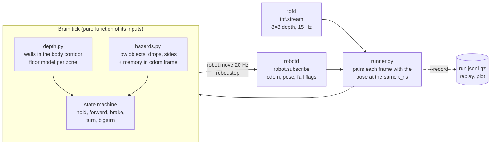

# microduck-brain

[](https://github.com/samoxis/microduck-brain/actions/workflows/tests.yml)

An autonomy layer for **Microduck**, the 25 cm open-source biped from Pollen Robotics / Hugging Face.
It runs as a separate client and talks to the robot only through its public JSON-RPC API over unix
sockets — the same calls `robotctl` makes — so it needs no changes to the robot's software.
Python 3.12, standard library only.

What the robot does with it:

- **walks and holds its heading**, cancelling the gait's drift with `odom.yaw` (a small PI loop);
- **steers around obstacles while walking**, and stops to turn in place only when there is no room;
- **avoids low objects** (7 cm cubes, 8 cm balls) that are only visible in the bottom rows of its
  8×8 depth sensor, using a geometric model of the floor;
- **keeps away from drops** (ledges, stairs going down);
- **remembers hazards it can no longer see**, in odometry coordinates;
- **stops sending walking commands when it falls or is unhealthy**, and resumes once it is upright;
- **records every decision** for exact offline replay and plots.


*A 300 s closed-loop run in the MuJoCo apartment scene (kinematic body, see below): the path
coloured by state, a rough map built from wall returns, the stairwell it kept away from (black), and
the low objects it went around (green). The recording is in [`docs/`](docs/) and replays exactly:
`uv run microduck-brain-replay docs/apartment-run.jsonl.gz`.*

## Results

| Where | What was measured | Result |
|---|---|---|
| Full simulator, official walking policies (run by the author) | v1 (before low objects and drops), 150 s in the apartment | 85 avoidances, only 4 needing a full stop; **0 falls**; area covered 4.5 × 3.4 m |
| Full simulator (run by the author) | Minimum commanded speeds at which the policy steps | 0.20 m/s forward, 1.1 rad/s turning; real speed ≈ 40% (forward) and 46–69% (turning) of commanded |
| MuJoCo apartment, kinematic body, real ToF model ([`tools/kinematic_apartment.py`](tools/kinematic_apartment.py)) | 12 runs × 300 s from 6 rooms, two real turn rates: 334 m walked | **0 toy contacts, 0 entries over the stairwell**, 2 grazes of furniture (down from 22, see *Findings*), 791 avoidances |
| Real MuJoCo sensor frames ([`tests/fixtures/`](tests/fixtures/)) | Floor model vs. the simulated sensor | error σ 0.8% (max 2.8%) |
| Real MuJoCo sensor frames | False alarms on empty floor, trunk tilted ±3° pitch and roll | **0** in 96 frames (low objects) and 0 in 304 frames (drops, incl. 64 frames across the apartment's rooms) |
| Test suite | 164 tests: synthetic and recorded frames, closed-loop worlds, a fake robot on real sockets, replay determinism | all passing, see the badge |

**What has not been verified**: anything on a physical robot (the author doesn't have one yet), and
the newest behaviour (low objects, drops, side memory) under the real walking dynamics, which needs the
full simulator — it is the next thing the author will run.

## Findings worth knowing

These came out of measuring rather than assuming, and each one changed the design:

1. **The policy has a dead zone.** Below 0.20 m/s forward or 1.1 rad/s turning the walking policy
   doesn't step at all; the first version (0.10 m/s) just stood still. The thresholds now live in the
   code and the brain warns at startup if the config is below them.
2. **Turns must be measured, not timed.** The robot turns at roughly half the commanded rate, so a
   timed 160° turn came out around 80°. Turns now close the loop on `odom.yaw`.
3. **A 7 cm cube is invisible within ~45 cm.** Standing, the sensor is 24.6 cm high and level; its
   lowest beam dips 19.7°. A cube closer than ~45 cm is *under* every beam — the frame is identical to
   an empty floor (verified on simulator frames). Detection works at 0.45–0.7 m, so the brain
   remembers what it saw and steers around it after it disappears.
4. **The stairwell is visible only through a window.** Approaching the 40 cm-wide side of the
   stairwell, its far floor is already beyond the lowest beam's landing point at ~0.3 m, so the hole
   vanishes from view; drops are remembered for 120 s. (In the simulator a beam into the hole returns
   "nothing in range" because it passes under the floor slab; a real sensor would see the step as a
   longer range — both count.)
5. **The foot of every wall looks like a low object.** The first closed-loop run reported 178 "low
   objects" in an apartment with 7 toys: 99.97% were wall bases seen by the bottom rows. A bottom-row
   reading now counts only if the wall rows above it are clear.
6. **The right leg brushed furniture.** In 12 runs, 22 contacts, *all* on the right side while
   walking straight: the sensor sits 2.2 cm left of the axis and "ahead" was defined as columns 1–6,
   so a post passing beside the right leg was never "ahead". "Ahead" is now the body's geometric
   corridor, and wall returns near the body are remembered for 3 s. Contacts dropped to 2, with the
   same area covered. The remaining two are the beak grazing a stool that was 54° to the right —
   outside the 45° field of view — while the robot arced away from something on its left; a longer
   memory didn't remove them, a wider view would (turning the head, or the camera).

## How it works



- **`depth.py`** turns a frame into a view ahead. For the bottom rows it computes, per zone, the
  range an empty floor would read, from the sensor's pose in `robot.state` (`frames.tof`,
  `safety.gravity`, `odom.position[2]`) — the same inputs the robot's own floor filter uses. Shorter
  means an object, longer (or nothing) means a drop.
- **`hazards.py`** confirms detections over time and remembers them in odometry coordinates.
- **`brain.py`** is the state machine. A safety guard sits above every state: fallen, unhealthy or
  blind means `hold`. New behaviours (dance, rest, play) are states registered with `brain.register()`.
- **`runner.py` / `ipc.py`** speak NDJSON JSON-RPC 2.0 to `robotd` and `tofd`, with the formats
  taken from `duck-ipc-proto` and `robotctl` rather than guessed.
- **`record.py`** writes every tick; because the brain is a pure function of its inputs, a recording
  replays exactly, and can be replayed with a different config to see what a change would have done.

## Quick start

On Linux or WSL, with Pollen's [`microduck`](https://github.com/pollen-robotics/microduck) and
[`microduck_rl`](https://github.com/pollen-robotics/microduck_rl) checked out and the simulator running:

```bash
curl -LsSf https://astral.sh/uv/install.sh | sh        # once
git clone https://github.com/samoxis/microduck-brain && cd microduck-brain

uv run microduck-brain                                  # Ctrl+C sends robot.stop and exits cleanly
uv run microduck-brain --duration 180 --record run.jsonl.gz
uv run microduck-brain-replay run.jsonl.gz              # must report 0 differing commands
uv run microduck-brain-plot run.jsonl.gz -o run.svg
uv run pytest                                           # the test suite
```

Sockets are found automatically (the simulator's under `~/.cache/duck-sim/`, else the robot's under
`/run/`); `--robot-socket` / `--tof-socket` override them. Every parameter is documented in
[`brain.toml`](brain.toml); unknown keys are rejected.

A complete, recorded run in the full simulator (starts it headless in the apartment if needed, checks
the duck stands and the world runs at real time, runs the brain, replays and plots; output in `runs/`):

```bash
bash tools/full_sim_run.sh                # 300 s; SECONDS_TO_RUN=600 for longer
```

The kinematic apartment runs and the simulator fixtures are regenerated with `microduck_rl`'s venv:

```bash
cd ~/microduck_rl && .venv/bin/python ~/microduck-brain/tools/kinematic_apartment.py --seconds 300 --svg run.svg
cd ~/microduck_rl && .venv/bin/python ~/microduck-brain/tools/capture_low_fixtures.py [--drop]
```

## Limitations

- Not yet run on a physical robot. The kinematic runs move the body ideally (no balance, no slip)
  with perfect odometry; the real gait sways more and the odometry drifts.
- An object that was never seen from a distance (already under the lowest beam) cannot be detected;
  nor can a drop narrower than the blind zone ahead (~0.7 m) approached from the side without having
  been seen. Glass is invisible to the sensor.
- After a fall the brain waits; it does not try to stand the robot up.
- The 45° field of view is narrow while turning (finding 6).

## How this was built

The author defined the goals, ran the full simulator with Pollen's walking policies, measured the
thresholds and failure modes (the dead zone, the turn rate, the drift, the pushed cubes), and decided
the direction at each version. The implementation, the simulator tooling and the tests were written
with [Claude Code](https://claude.com/claude-code), Anthropic's agentic coding tool, which is why most
commits are co-authored. Every behaviour was checked against measurements before being kept, and the
README reports what was not verified as plainly as what was.

## License

[Apache License 2.0](LICENSE), the same license as Pollen's `microduck` and `microduck_rl`.
The test fixtures in `tests/fixtures/` are sensor frames generated by running `microduck_rl`'s simulator.
